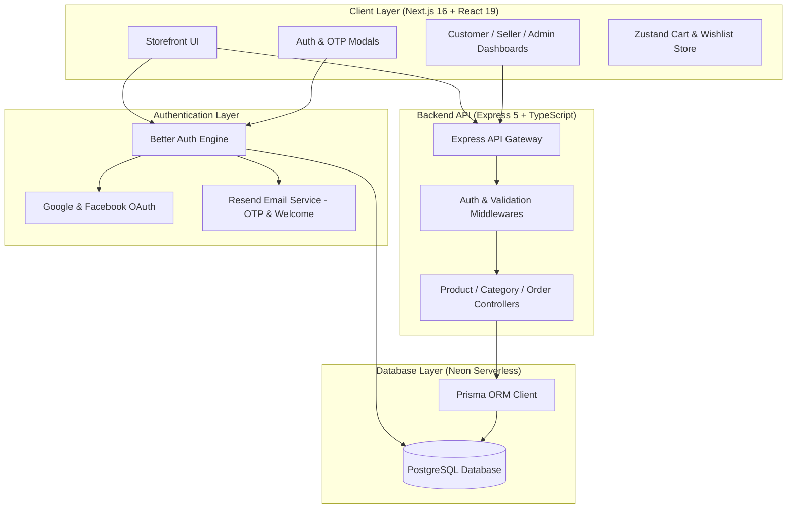

# 🛒 eShopBD — Modern Multi-Vendor eCommerce Platform

[](https://nextjs.org/)
[](https://react.dev/)
[](https://www.typescriptlang.org/)
[](https://tailwindcss.com/)
[](https://better-auth.com/)
[](https://neon.tech/)
[](https://www.prisma.io/)
[](https://resend.com/)
[](https://e-shop-bd-gamma.vercel.app)
[](https://eshopbd-server.onrender.com)

---

## 🌟 Overview

**eShopBD** is a production-grade, multi-vendor eCommerce platform engineered with cutting-edge web technologies. Built with Next.js 16 (App Router), React 19, TypeScript, and Tailwind CSS v4, eShopBD offers an ultra-fast, smooth, and secure shopping experience. 

The platform features seamless authentication powered by **Better Auth**, serverless **Neon PostgreSQL** database with **Prisma ORM**, automated transactional emails via **Resend API**, and distinct role-based access for Customers, Sellers, and Administrators.

### 🔗 Live Demos & Endpoints
- **Frontend Storefront**: [https://e-shop-bd-gamma.vercel.app](https://e-shop-bd-gamma.vercel.app)
- **Backend API Service**: [https://eshopbd-server.onrender.com](https://eshopbd-server.onrender.com)
- **API Health Check**: [https://eshopbd-server.onrender.com/api/health](https://eshopbd-server.onrender.com/api/health)

---

## 🚀 Key Features

### 🛍️ Storefront & Shopping Experience
- **Hero & Promotional Showcases**: Interactive banners with smooth carousel sliders and promotional campaigns (Mega Deals, Electronics, Toys & Kids, Best Sellers).
- **Advanced Product Catalog**: Multi-attribute filtering (category, price range, brand, ratings, stock status) and instant search.
- **Product Details Page**: High-resolution image galleries, dynamic variant selection, real-time inventory checks, and customer reviews.
- **Cart & Wishlist**: Persistent cart and wishlist powered by Zustand with instant quantity updates and pricing breakdown.
- **Streamlined Checkout**: Step-by-step checkout with delivery address selection, coupon code redemption, and payment method options (Cash on Delivery, bKash, Nagad, Cards).
- **Order Tracking**: Real-time order progress timeline (Pending ➔ Confirmed ➔ Processing ➔ Shipped ➔ Delivered).

### 🔐 Modern Authentication & Security
- **Better Auth Integration**: Production-tested authentication suite with secure session management and HTTP-only cookies.
- **Multiple Login Methods**:
  - Email & Password with strong password validation and bcrypt hashing.
  - Social OAuth 2.0 (Google & Facebook Login).
- **6-Digit Email OTP Verification**: Automated OTP verification for sign-up using Resend email delivery.
- **Automated Welcome Email**: Beautiful, branded welcome email with coupon codes (`WELCOME10`) dispatched instantly upon account creation.
- **Role-Based Access Control (RBAC)**: Strict route protection and permission layers for `CUSTOMER`, `SELLER`, and `ADMIN`.

### 👥 Dedicated Portals & Dashboards
- **Customer Dashboard**: Manage profile details, order history, active shipments, delivery addresses, and wishlisted items.
- **Seller Portal**: Seller registration (`/become-seller`), multi-step store setup, product creation and inventory management.
- **Admin Panel**: High-level store metrics, user account moderation, order lifecycle management, and catalog oversight.

### 🎨 Visual & Motion Design
- **Tailwind CSS v4**: Ultra-clean, modern component styling utilizing CSS variables and modern utility tokens.
- **Framer Motion**: Smooth entry animations, fluid layout transitions, and interactive UI micro-interactions.
- **Lenis Smooth Scroll**: Butter-smooth inertial scrolling for an enhanced desktop and mobile browsing experience.
- **Interactive Feedback**: Canvas Confetti celebration effects on successful orders, along with Sonner & React Hot Toast alerts.

---

## 🏗️ Architecture & Data Flow



---

## 💻 Tech Stack

| Domain | Technologies & Libraries |
| :--- | :--- |
| **Framework** | [Next.js 16.3 (App Router)](https://nextjs.org/), [React 19.2](https://react.dev/) |
| **Language** | [TypeScript 5](https://www.typescriptlang.org/) |
| **Styling & Icons** | [Tailwind CSS v4](https://tailwindcss.com/), [Lucide React](https://lucide.dev/), [React Icons](https://react-icons.github.io/react-icons/) |
| **Motion & UX** | [Framer Motion](https://www.framer.com/motion/), [Lenis](https://lenis.darkroom.engineering/), [Canvas Confetti](https://www.npmjs.com/package/canvas-confetti), [Embla Carousel](https://www.embla-carousel.com/), [Swiper](https://swiperjs.com/) |
| **State Management** | [Zustand](https://zustand-demo.pmnd.rs/), [TanStack React Query](https://tanstack.com/query) |
| **Forms & Validation** | [React Hook Form](https://react-hook-form.com/), [Zod](https://zod.dev/) |
| **Notifications** | [Sonner](https://sonner.emilkowal.ski/), [React Hot Toast](https://react-hot-toast.com/) |
| **Authentication** | [Better Auth 1.7](https://better-auth.com/), Google OAuth, Facebook OAuth |
| **Email Delivery** | [Resend API](https://resend.com/) (Transactional OTPs & Welcome emails) |
| **Backend API** | [Node.js](https://nodejs.org/), [Express 5](https://expressjs.com/), [Prisma 6.4](https://www.prisma.io/) |
| **Database** | [Neon Serverless PostgreSQL](https://neon.tech/) |
| **Deployment** | [Vercel](https://vercel.com/) (Frontend), [Render](https://render.com/) (Backend API) |

---

## 📂 Project Folder Structure

```text
eShopBD-Client/
├── public/                     # Static assets, SVG icons, promotional images
├── src/
│   ├── app/                    # Next.js 16 App Router
│   │   ├── (auth)/             # Authentication route group
│   │   │   ├── become-seller/  # Seller registration & onboarding
│   │   │   ├── login/          # Customer & vendor sign-in
│   │   │   ├── register/       # User registration with OTP modal
│   │   │   └── layout.tsx      # Auth pages layout wrapper
│   │   ├── (dashboard)/        # Role-based dashboard route group
│   │   │   ├── admin/          # Admin control panel
│   │   │   ├── customer/       # Customer orders & profile
│   │   │   └── seller/         # Vendor inventory & analytics
│   │   ├── (storefront)/       # Public eCommerce storefront
│   │   │   ├── best-sellers/   # Top-selling product catalog
│   │   │   ├── cart/           # Shopping cart review
│   │   │   ├── categories/     # Category hierarchy browsing
│   │   │   ├── checkout/       # Multi-step checkout & payment
│   │   │   ├── electronics/    # Electronics dedicated page
│   │   │   ├── mega-deals/     # Flash discounts & promotions
│   │   │   ├── new-arrivals/   # Recently launched inventory
│   │   │   ├── offers/         # Special campaigns & vouchers
│   │   │   ├── products/       # Product list & [id] detail page
│   │   │   ├── toys/           # Kids & Toys collection
│   │   │   ├── track-order/    # Real-time shipment status tracker
│   │   │   ├── layout.tsx      # Main layout (Navbar, Footer, Providers)
│   │   │   └── page.tsx        # Homepage hero & product grids
│   │   ├── api/
│   │   │   └── auth/           # Better Auth catch-all API handler
│   │   ├── globals.css         # Tailwind CSS v4 styling directives
│   │   └── layout.tsx          # Root HTML & metadata layout
│   ├── components/             # Reusable UI component modules
│   │   ├── common/             # Global headers, footers, search bar, modals
│   │   └── ...                 # Banners, product cards, category badges
│   ├── data/                   # Initial mock & seed product data
│   ├── features/               # Modular domain logic
│   │   ├── auth/               # Auth modal, OTP verification form, login components
│   │   ├── products/           # Product filters, cards, reviews, image gallery
│   │   └── seller/             # Seller application forms & steps
│   ├── lib/                    # Shared utility instances
│   │   ├── auth.ts             # Better Auth server configuration
│   │   ├── auth-client.ts      # Better Auth client hooks (useSession, signIn, signOut)
│   │   ├── db.ts               # Neon PostgreSQL connection pooling client
│   │   └── email.ts            # Resend email templates (OTP & Welcome email)
│   ├── schemas/                # Zod validation schemas (Auth, Seller, Checkout)
│   ├── services/               # API client service wrappers (Axios / Fetch)
│   ├── store/                  # Zustand global state slices (Cart, Wishlist, UI)
│   └── types/                  # TypeScript interface & type declarations
├── .env.local                  # Local environment configuration
├── next.config.ts              # Next.js build configuration
├── package.json                # Project dependencies and npm scripts
├── tsconfig.json               # TypeScript compiler configuration
└── README.md                   # Project documentation
```

---

## ⚙️ Environment Variables

Create a `.env.local` file in the root of `eShopBD-Client` and supply the following configuration keys:

```env
# Better Auth Configuration
BETTER_AUTH_SECRET="your-super-secret-random-32-char-string"
BETTER_AUTH_URL="http://localhost:3000"

# Database Connection (Neon Serverless PostgreSQL)
DATABASE_URL="postgresql://<user>:<password>@<host>/<database>?sslmode=require"

# Resend Email Delivery API
RESEND_API_KEY="re_xxxxxxxxxxxxxxxxxxxxxxxxxx"

# Social Authentication Credentials
GOOGLE_CLIENT_ID="your-google-oauth-client-id.apps.googleusercontent.com"
GOOGLE_CLIENT_SECRET="your-google-oauth-client-secret"
FACEBOOK_CLIENT_ID="your-facebook-app-id"
FACEBOOK_CLIENT_SECRET="your-facebook-app-secret"

# External Backend Server API
NEXT_PUBLIC_API_URL="https://eshopbd-server.onrender.com"
```

> **Note**: For production deployments on Vercel, set `BETTER_AUTH_URL` to your production domain (e.g. `https://e-shop-bd-gamma.vercel.app`) or omit it to leverage dynamic origin resolution.

---

## 🛠️ Installation & Getting Started

### Prerequisites
- [Node.js](https://nodejs.org/) (v20.x or later recommended)
- [npm](https://www.npmjs.com/) or [pnpm](https://pnpm.io/)
- A free [Neon](https://neon.tech/) PostgreSQL database instance
- A [Resend](https://resend.com/) API account for email delivery

### 1. Clone the Repository
```bash
git clone https://github.com/Asmual/eShopBD.git
cd eShopBD
```

### 2. Install Dependencies
```bash
npm install
```

### 3. Configure Environment Variables
Copy the sample environment variables into `.env.local`:
```bash
cp .env.example .env.local
```
Fill in your database URL, OAuth client secrets, and Resend API key.

### 4. Run the Development Server
```bash
npm run dev
```

Open [http://localhost:3000](http://localhost:3000) with your browser to experience the application.

---

## 📜 Available NPM Scripts

| Command | Purpose |
| :--- | :--- |
| `npm run dev` | Runs the Next.js development server with hot-reloading |
| `npm run build` | Compiles the production build |
| `npm run start` | Starts the production server |
| `npm run lint` | Executes ESLint to check code formatting and errors |

---

## 🌐 Deployment

### Frontend (Vercel)
1. Push your repository to GitHub (`https://github.com/Asmual/eShopBD`).
2. Import the project into your [Vercel Dashboard](https://vercel.com/).
3. Add the environment variables listed in the [Environment Variables](#️-environment-variables) section.
4. Set Framework Preset to **Next.js**.
5. Deploy! Vercel automatically rebuilds on every `main` push.

### Backend (Render)
1. Repository: [eShopBD-Server](https://github.com/Asmual/eShopBD-Server).
2. Create a new Web Service on [Render](https://render.com/).
3. Set the build command to:
   ```bash
   npm install && npm run build
   ```
4. Set the start command to:
   ```bash
   npm start
   ```
5. Ensure the CORS allowed origins include your Vercel domain.

---

## 🤝 Contributing

Contributions, issues, and feature requests are welcome! Feel free to check the [issues page](https://github.com/Asmual/eShopBD/issues).

1. Fork the Project
2. Create your Feature Branch (`git checkout -b feature/AmazingFeature`)
3. Commit your Changes (`git commit -m 'Add some AmazingFeature'`)
4. Push to the Branch (`git push origin feature/AmazingFeature`)
5. Open a Pull Request

---

## 📄 License

Distributed under the MIT License. See `LICENSE` for more information.

---

<p align="center">
  Developed with ❤️ by <a href="https://github.com/Asmual">Asmual</a>
</p>
